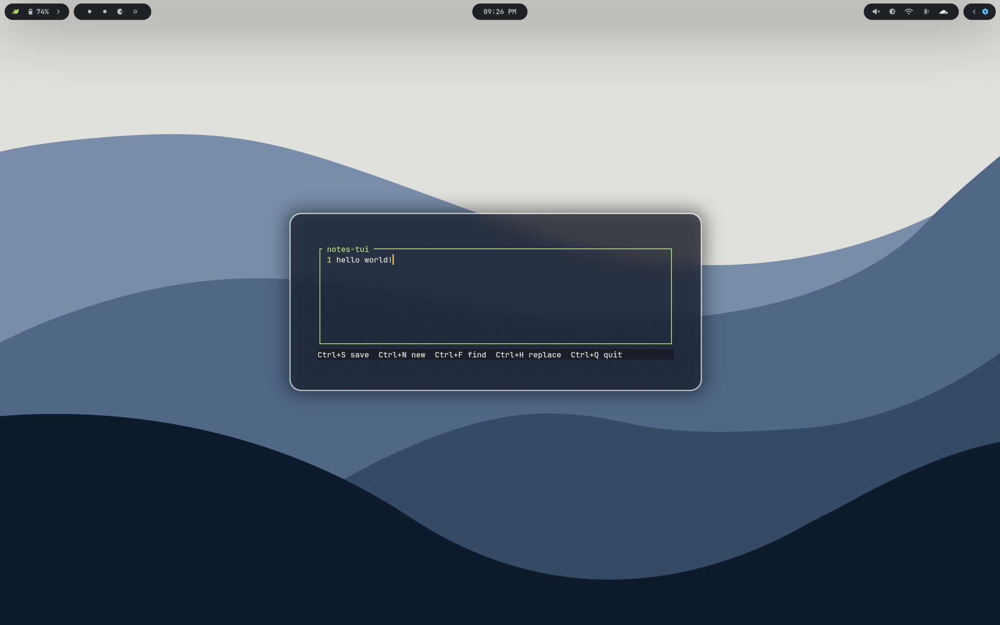

# notes-tui — Minimal Rust Notepad TUI



Single-buffer Notepad clone in the terminal. Autosaves to a hidden file, exports to `~/Downloads/notes/`, no open dialog.

Linux only (`x86_64` / `aarch64`). Requires a mouse-enabled terminal.

## Install (Linux)

### Quick install (recommended)

```bash
curl -fsSL https://raw.githubusercontent.com/ItsNotArjun/notes-tui/main/install.sh | bash
```

This tries a prebuilt binary for your arch, falls back to building from source if no release exists yet. Installs to `~/.local/bin/notes`.

Options:

```bash
# Build from source even if a prebuilt exists
curl -fsSL https://raw.githubusercontent.com/ItsNotArjun/notes-tui/main/install.sh | bash -s -- --from-source

# Install elsewhere / pinned version
./install.sh --dir ~/.local/bin --tag v0.1.0
INSTALL_DIR=~/bin ./install.sh
```

Then:

```bash
hash -r
notes --version
notes
```

### Manual install from source

Requirements: `git`, `cc`, `curl`, Rust stable.

```bash
git clone https://github.com/ItsNotArjun/notes-tui.git
cd notes-tui
cargo install --path . --root ~/.local --force
~/.local/bin/notes --version
```

Fedora:

```bash
sudo dnf install -y git gcc curl
```

Ubuntu/Debian:

```bash
sudo apt update && sudo apt install -y git build-essential curl
```

Rust (if `cargo` missing):

```bash
curl --proto '=https' --tlsv1.2 -sSf https://sh.rustup.rs | sh -s -- -y --profile minimal
. "$HOME/.cargo/env"
```

### PATH

`~/.local/bin` is on PATH on most distros. If `which notes` finds nothing:

```bash
export PATH="$HOME/.local/bin:$PATH"
```

Add that line to `~/.bashrc` or `~/.zshrc`, then restart the shell.

Verify:

```bash
which notes
notes --version
notes --help
```

### Clipboard backends

Copy/paste uses the system clipboard via `arboard`, with internal fallback.

- Wayland: `sudo dnf install wl-clipboard` / `sudo apt install wl-clipboard`
- X11: `sudo dnf install xclip` / `sudo apt install xclip`
- Headless/SSH: falls back to internal yank buffer.

> Most terminals reserve `Ctrl+Shift+C/V` for themselves and never send them
> to TUIs. Use `Ctrl+C` / `Ctrl+V` / `Ctrl+X` (or `Ctrl+Insert` /
> `Shift+Insert`) inside `notes` — those are forwarded and sync to system.

### Terminal notes

- Enable mouse reporting in your terminal (most do by default).
- `Ctrl+Backspace` (word delete) vs `Ctrl+H` (replace) share `0x08` on legacy terminals. We enable Kitty `DISAMBIGUATE_ESCAPE_CODES` so modern terminals (kitty, wezterm, alacritty, recent xterm/gnome-terminal) report them distinctly. If yours still opens replace on `Ctrl+Backspace`, use `Ctrl+W` (same action).
- Cursor is a real terminal I-beam (`SteadyBar`) positioned from the textarea screen cursor. Requires `DECSCUSR` support (most modern terminals).

## Update / uninstall

```bash
# Update to latest
curl -fsSL https://raw.githubusercontent.com/ItsNotArjun/notes-tui/main/install.sh | bash -s -- --from-source

# Or if installed via cargo
cargo install --git https://github.com/ItsNotArjun/notes-tui --root ~/.local --force

# Uninstall
rm -f ~/.local/bin/notes
# Config/autosave left intact at ~/.config/notes-tui/
```

## Usage

```bash
notes
notes --help
notes --version
```

### Keys

- Type / Arrows: edit + move
- Mouse click: move cursor, drag: select
- `Tab` / `Shift+Tab`: indent / dedent (4 spaces)
- `Ctrl+C` / `Ctrl+V` / `Ctrl+X`: copy / paste / cut (system clipboard, internal fallback). `Ctrl+Shift+C/V` and `Ctrl+Insert` / `Shift+Insert` also work where the terminal forwards them.
- `Ctrl+Z` / `Ctrl+Shift+Z`: undo / redo
- `Ctrl+Backspace` (or `Ctrl+W`): delete word backward — `Ctrl+Delete`: delete word forward
- `Ctrl+S`: Save As prompt — always to `~/Downloads/notes/<name>.txt`
- `Ctrl+N`: clear/new (view cleared, old autosave kept until next typing)
- `Ctrl+F`: find popup, `Enter` next
- `Ctrl+H`: replace popup, `Enter` replace-one, `Ctrl+A` replace-all, `Tab` switch field
- `Ctrl+Q`: quit (autosave retained)
- `Esc`: close popup / cancel, clears find highlight

Wrap + green line numbers are always on. Border + title are green.

## Files

- Autosave: `~/.config/notes-tui/autosave.txt` (created on first edit, loaded on launch)
- Export: `~/Downloads/notes/` (auto-created, overwrite asks y/n)
- `src/storage.rs`: autosave + export + filename sanitize
- `src/find.rs`: literal unicode-safe find/replace
- `src/app.rs`: state machine + editing ops
- `src/ui.rs`: rendering + popups + I-beam cursor positioning
- `src/main.rs`: terminal + event loop + mouse + keyboard enhancements
- `install.sh`: Linux installer (prebuilt or source)
- `.github/workflows/release.yml`: builds `notes-linux-x86_64/aarch64.tar.gz` on tag `v*`

## Build from checkout

```bash
cargo test
cargo build
./target/debug/notes --help
```

17 unit tests: storage roundtrip, sanitize, overwrite guard, find positions/unicode/wrap, replace counts, clear + tab, find-highlight clear, word delete backward/forward, copy/cut selection.

## Troubleshooting

```bash
which notes
notes --version
ls -l ~/.local/bin/notes
echo $PATH
```

- `notes: command not found` → PATH issue, see above.
- Empty launch after `Ctrl+N` + quit without typing is expected: autosave is kept until next typing.
- `Ctrl+Backspace` opens replace → terminal conflates it with `Ctrl+H`; use `Ctrl+W` or switch to kitty/wezterm/alacritty.
- No mouse select → enable mouse reporting in terminal settings.
- Clipboard copy fails → install `wl-clipboard`/`xclip`, or rely on internal fallback.
